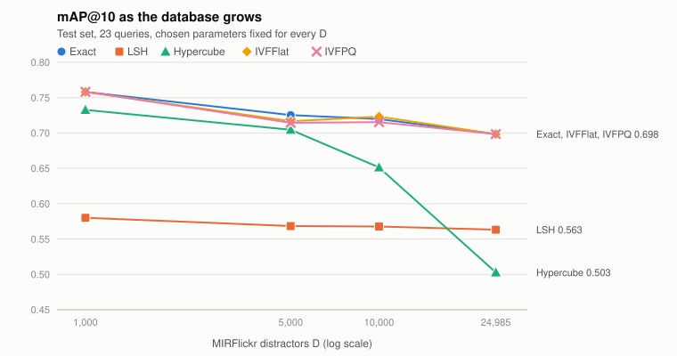
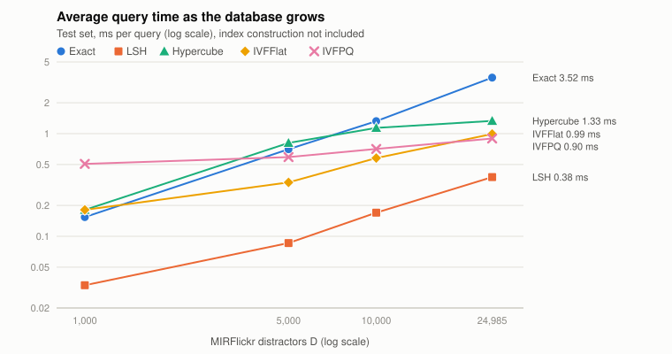

# Image Retrieval with Bag-of-Visual-Words Vectors: Exact Search, LSH, Hypercube, IVFFlat and IVFPQ

Authors: 
* ΚΑΝΕΛΛΑΚΗ ΜΑΡΙΑ 1115202300060
* ΒΟΪΣΤΡΙΚΟΒ ΝΙΚΗΤΑ 1115202300019

## Abstract

Every image is represented by a 256-dimensional bag-of-visual-words histogram built from SIFT descriptors,
and the five images most similar to a query are retrieved with five methods: exhaustive search, LSH,
randomized projection on the hypercube, IVFFlat and IVFPQ. Each method's parameters were tuned on the
validation split of HPatches with 24,985 MIRFlickr distractor images. They were then evaluated once on
the test split with 1,000 to 24,985 distractors. At the largest database (25,100 images) IVFFlat and
IVFPQ return the same mAP@10 as exact search (0.698) at 3.5× and 3.9× its speed. IVFPQ also stores each
vector in 128 bytes instead of 1,024. LSH is the fastest method (9× faster than exact) but loses about
0.13 mAP. The Hypercube is the weakest at 25k images, because its candidate limit covers a shrinking
fraction of the database. During tuning we also found that an early-stopping method appears better than
exact search if the relevant images are stored ahead of the distractors. Shuffling the database removed
this effect.

## 1. Task

For each HPatches sequence, image 1 is the query. Images 2–6 of the same sequence are the five relevant
images, and they are stored in the database together with the first `D` MIRFlickr images, which serve
as distractors. A method returns 10 database images per query, and we measure:

* **Recall@5 and Recall@10:** the fraction of the 5 relevant images found in the top 5 and top 10.
* **AP@10:** `(1/5) Σ j / r_j` over the relevant images found at ranks `r_1 < r_2 < …` in the top 10.
  **mAP@10** is its mean over the queries.
* **Average query time:** the time of the `query()` call alone. Index construction is excluded.

The HPatches split has 70 training, 23 validation and 23 test sequences, so each query set has 23
queries: 11 illumination sequences (`i_*`) and 12 viewpoint sequences (`v_*`).

## 2. Vector representation

* **SIFT:** OpenCV's SIFT with default parameters, on grayscale images.
* **Vocabulary:** k-means with **K = 256** centres (k-means++ initialization, at most 25 Lloyd
  iterations). It is trained on at most **S = 500** randomly sampled descriptors from each of the 420
  images of the training sequences. Validation, test and MIRFlickr images are never used for training.
* **Encoding:** every descriptor of an image is assigned to its nearest centre, and the histogram is
  divided by the number of descriptors, so every vector sums to 1.
* **Distance:** Euclidean (squared Euclidean internally, which gives the same ranking).

**MIRFlickr images.** 15 of the 25,000 MIRFlickr images have no SIFT descriptors, so they have no
vector. They are skipped, and `D` means "the first `D` valid images in numeric order". The largest
possible value is therefore **D = 24,985**, a database of 25,100 images, and that is what the
"D = 25,000" experiments use.

The vectors depend only on (K, S, seed, split file), so they are computed once and stored in a cache
file. Every run of the study loads that file. K and S were kept at the values above and were not tuned:
a different K or S means running SIFT on all 25,000 images again, which takes hours (Section 8).

## 3. Methods

Every method returns the 10 best rows sorted by (distance, row index), so ties are resolved the same way
every time. The approximate methods compute the exact distance for every candidate they examine, except
IVFPQ, which ranks by its approximate (quantized) distance. The README describes each implementation
in detail.

| Method | Index | Query |
|---|---|---|
| Exact | none | all `n` distances, bounded max-heap of size 10 |
| LSH | `L` hash tables. Each key combines `k` values `h(p) = ⌊(v·p + t)/w⌋` with `v ~ N(0,1)^256`, `t ~ U[0,w)` | union of the query's `L` buckets |
| Hypercube | each point goes to vertex `(f_1(h_1(p)), …, f_kproj(h_kproj(p)))` of a `kproj`-dimensional cube. `f_i` maps each integer to a fixed pseudo-random bit | vertices in increasing Hamming distance, until `probes` vertices or `M` candidates |
| IVFFlat | k-means with `kclusters` centroids, one inverted list per centroid | the lists of the `nprobe` nearest centroids |
| IVFPQ | as IVFFlat, but each residual `x − c` is split into `M` sub-vectors, each quantized to one of `2^nbits` centroids | lookup table per probed list, distance = sum of `M` table entries (ADC) |

## 4. Experimental protocol

* **Tuning:** on the validation set with D = 24,985, the hardest database. Each parameter grid was run
  at least twice, and every run gave identical results apart from the measured time. The scripts are
  `scripts/tune.sh` and `scripts/experiments.sh`, and every run is recorded in `results/tune_*.csv`.
* **Selection rule:** for each method we chose the setting with the highest mAP@10 that is still
  clearly faster than exact search, aiming for at least 2.5× (LSH and the IVF methods reached 5–7× in
  tuning). A setting that matches exact search but is slower than it is of no use.
* **Timing:** the chosen settings of all five methods were then run three times one after the other on
  validation (`results/repeat.csv`), so the times are compared under the same machine load.
* **Test:** the chosen settings were run **once** on the test set for D ∈ {1,000, 5,000, 10,000,
  24,985} (`results/test.csv`). They were not changed after the test results were seen.
* **Setup:** Intel Core i7-14700HX, 16 GB RAM, Ubuntu 24.04, g++ 13.3 with `-O2`, OpenCV 4.6.
  Queries run on one thread, and the seed is 1 for everything.
* **Database order:** the database rows are shuffled with the seed before any index is built (Section 5.2).

## 5. Parameter tuning (validation, D = 24,985)

Exact search gives mAP@10 = **0.746** on validation, which is the reference for the four approximate
methods. Its time varied between runs (3.3–5.3 ms), so each table below is read against the exact-search
time measured in the same session.

### 5.1 LSH

Grid: `k` ∈ {2, 4, 6, 8}, `L` ∈ {5, 10, 15, 20}, `w` ∈ {0.05, 0.1, 0.2, 0.3} (64 settings). The table
lists the settings with the highest mAP for their query time (exact search: about 5 ms in this session).

| k | L | w | mAP@10 | ms |
|---|---|---|---|---|
| 6 | 15 | 0.05 | 0.339 | 0.10 |
| 8 | 15 | 0.1 | 0.593 | 0.65 |
| **8** | **20** | **0.1** | **0.607** | **0.84** |
| 6 | 20 | 0.1 | 0.652 | 2.4 |
| 4 | 10 | 0.1 | 0.700 | 3.8 |
| 4 | 15 | 0.1 | 0.731 | 4.6 |

* **`w` sets the bucket width.** The vectors sum to 1 and their projections are small, so `w = 0.05`
  produces many tiny buckets. With `k = 8` and `w = 0.05`, up to 16 of the 23 queries got fewer than 10
  results. `w = 0.2–0.3` with small `k` puts almost everything in one bucket: `k = 2, L = 20, w = 0.3`
  reproduces exact search (0.746) but takes 12 ms, more than exact search itself.
* **`k` and `L` pull in opposite directions.** A larger `k` makes buckets more selective; a larger `L`
  gives a near neighbour more chances to share a bucket with the query. The best trade-offs pair a large
  `k` with a large `L`.
* **Chosen: `k = 8, L = 20, w = 0.1`**, 81 % of exact-search mAP at about 6× its speed. One validation
  query gets fewer than 10 results. With `k = 8, w = 0.1` the mAP was still rising at the largest `L` of
  the grid (0.43, 0.48, 0.59, 0.61 for L = 5–20), so more tables would probably raise it further, at a
  higher query time and memory cost.

### 5.2 Hypercube, and the database-order effect

The first Hypercube grid appeared to *beat* exact search. For example, `kproj = 6, w = 0.2, M = 200,
probes = 5` gave mAP@10 = 0.775 with R@10 = 0.826 (exact search: 0.746 and 0.765) in only 0.06 ms,
examining 200 of 25,100 images. We tested this by building the same index on the database rows in
reverse order:

| `kproj = 6, w = 0.2` | Original order (HPatches rows first) | Reversed order |
|---|---|---|
| `M = 100, probes = 3` | 0.766 | **0.000** |
| `M = 500, probes = 10` | 0.768 | **0.000** |
| no `M` limit | 0.746 | 0.746 |

**What caused it:**
1. With `w = 0.2`, almost every image lands on the same few vertices.
2. Buckets are filled in row order, and the database stored the 115 HPatches images (all the relevant
   ones) in rows 0–114, ahead of every distractor.
3. When `M` cut a bucket off, the candidates always contained every relevant image and almost no
   distractors.

**The fix.** The database is now shuffled with the seed when it is built, keeping the image ids
aligned with the rows. Exact search, LSH, IVFFlat and IVFPQ never stop early, and their outputs did not
change. All Hypercube tuning was repeated after the fix.

**Results after the fix.** Grid: `kproj` ∈ {10, 12, 14, 16}, `w` ∈ {0.03, 0.05, 0.1, 0.15},
(`M`, `probes`) ∈ {(1000, 100), (2000, 300), (5000, 1000), (10000, 2000), (20000, 5000)}. Exact search
took about 5.3 ms in this session.

| kproj | w | M | probes | mAP@10 | ms |
|---|---|---|---|---|---|
| 14 | 0.1 | 2000 | 300 | 0.395 | 0.84 |
| 16 | 0.05 | 5000 | 1000 | 0.485 | 1.58 |
| **14** | **0.1** | **5000** | **1000** | **0.561** | **2.08** |
| 16 | 0.15 | 10000 | 2000 | 0.694 | 3.93 |
| 16 | 0.1 | 20000 | 5000 | 0.746 | 7.36 |

* **The Hypercube needs many probes.** Each point is stored on a single vertex, so close points end up
  on neighbouring vertices more often than on the same one, and good recall needs hundreds of probed
  vertices.
* **It reaches exact-search quality only when it examines most of the database**, and then it is slower
  than exact search.
* **Chosen: `kproj = 14, w = 0.1, M = 5000, probes = 1000`**, 75 % of exact-search mAP at 2.5× its speed.

### 5.3 IVFFlat

Grid: `kclusters` ∈ {50, 100, 159 (= ⌈√n⌉, the default), 300, 500, 750, 1000}, `nprobe` ∈ {1, …, 40}.
Exact search took about 5.2 ms in this session.

| kclusters | nprobe | mAP@10 | ms |
|---|---|---|---|
| 300 | 2 | 0.548 | 0.39 |
| 1000 | 10 | 0.700 | 0.62 |
| 500 | 10 | 0.714 | 0.99 |
| **1000** | **20** | **0.732** | **1.02** |
| 500 | 40 | 0.746 | 3.27 |

* **More clusters than the default worked better.** For the same mAP the lists are smaller, so queries
  are faster: 159/10 gives 0.728 in 2.3 ms, 1000/20 gives 0.732 in 1.0 ms. The cost is in the build: the
  k-means takes about 54 s with 1,000 clusters, against about 8 s with 159.
* **`nprobe = 40` with 500 clusters returns exactly the exact-search results** at 1.6× its speed: 8 % of
  the lists already contain every true top-10 neighbour. Probing all lists also reproduces exact search
  exactly, which we used as a correctness check of the implementation.
* **Chosen: `kclusters = 1000, nprobe = 20`.**

### 5.4 IVFPQ

The coarse quantizer was fixed to the chosen IVFFlat setting (`kclusters = 1000, nprobe = 20`). The grid
was `M` ∈ {8, 16, 32, 64} × `nbits` ∈ {6, 8, 10}, followed by three runs beyond its edges: `M = 128,
nbits = 6`, `M = 64, nbits = 4`, and `nprobe = 10` with `M = 64, nbits = 6` (0.670 in 0.43 ms).

| M | nbits | mAP@10 | ms | bytes per vector |
|---|---|---|---|---|
| 16 | 6 | 0.602 | 0.56 | 16 |
| 32 | 6 | 0.689 | 0.58 | 32 |
| 64 | 6 | 0.705 | 0.71 | 64 |
| 64 | 8 | 0.727 | 1.30 | 64 |
| **128** | **6** | **0.735** | **0.91** | **128** |
| 64 | 10 | 0.729 | 3.70 | 128 |

* **`M` matters more than `nbits`.** From M = 8 to 64 (nbits 6) the mAP rises from 0.448 to 0.705.
  At M = 64, going from nbits 6 to nbits 10 adds only 0.024 and makes queries 5× slower.
* **Larger `nbits` costs time because of the lookup table.** Each probed list needs an M × 2^nbits
  table (64 × 1,024 entries at nbits = 10), filled 20 times per query. The lists hold only about 25
  vectors each, so filling the table costs more than scanning the codes.
* **With M = 128 each sub-vector has 2 coordinates**, and 64 centroids describe that 2-D space almost
  without error, so the ranking is practically the exact one.
* **Chosen: `M = 128, nbits = 6`**, 8× smaller vectors than IVFFlat, with the same mAP.

### 5.5 Repeated timing of the chosen settings (validation)

The chosen settings were run three times, one method after the other. mAP was identical in all three runs.

| Method | Parameters | mAP@10 | R@10 | ms (mean of 3) | range | speed-up |
|---|---|---|---|---|---|---|
| Exact | – | 0.746 | 0.765 | 3.73 | 3.31–4.43 | 1.0× |
| LSH | k 8, L 20, w 0.1 | 0.607 | 0.635 | 0.54 | 0.45–0.68 | 6.9× |
| Hypercube | kproj 14, w 0.1, M 5000, probes 1000 | 0.561 | 0.591 | 1.34 | 1.29–1.39 | 2.8× |
| IVFFlat | kclusters 1000, nprobe 20 | 0.732 | 0.748 | 1.04 | 1.01–1.07 | 3.6× |
| IVFPQ | kclusters 1000, nprobe 20, M 128, nbits 6 | 0.735 | 0.757 | 0.92 | 0.91–0.93 | 4.1× |

Exact search runs faster here than in some tuning sessions, so the final speed-ups are smaller than the
tuning tables suggest. The third run was slower for exact search and LSH, which scan more memory per
query; the IVF times varied by only ±3 %.

## 6. Results on the test set

The parameters are those of Section 5. For every D the database is the 115 test-sequence images plus
D MIRFlickr images.

### 6.1 All queries

| D | Method | R@5 | R@10 | mAP@10 | ms | < 10 results |
|---|---|---|---|---|---|---|
| 1,000 | Exact | 0.739 | 0.817 | 0.758 | 0.15 | 0 |
| | LSH | 0.565 | 0.609 | 0.580 | 0.03 | 4 |
| | Hypercube | 0.713 | 0.783 | 0.733 | 0.18 | 0 |
| | IVFFlat | 0.739 | 0.817 | 0.758 | 0.18 | 0 |
| | IVFPQ | 0.730 | 0.817 | 0.758 | 0.51 | 0 |
| 5,000 | Exact | 0.713 | 0.783 | 0.725 | 0.70 | 0 |
| | LSH | 0.565 | 0.600 | 0.568 | 0.09 | 2 |
| | Hypercube | 0.696 | 0.757 | 0.705 | 0.81 | 0 |
| | IVFFlat | 0.704 | 0.774 | 0.717 | 0.34 | 0 |
| | IVFPQ | 0.704 | 0.774 | 0.714 | 0.59 | 0 |
| 10,000 | Exact | 0.704 | 0.774 | 0.720 | 1.32 | 0 |
| | LSH | 0.557 | 0.600 | 0.568 | 0.17 | 1 |
| | Hypercube | 0.635 | 0.696 | 0.651 | 1.14 | 0 |
| | IVFFlat | 0.704 | 0.783 | 0.723 | 0.58 | 0 |
| | IVFPQ | 0.696 | 0.765 | 0.715 | 0.71 | 0 |
| 24,985 | Exact | 0.678 | 0.748 | 0.698 | 3.52 | 0 |
| | LSH | 0.557 | 0.591 | 0.563 | 0.38 | 0 |
| | Hypercube | 0.504 | 0.522 | 0.503 | 1.33 | 0 |
| | IVFFlat | 0.678 | 0.748 | 0.698 | 0.99 | 0 |
| | IVFPQ | 0.687 | 0.739 | 0.698 | 0.90 | 0 |

*Figure 1. mAP@10 on the test set against the number of distractors. Exact search, IVFFlat and IVFPQ
overlap almost everywhere.*

*Figure 2. Average query time on the test set against the number of distractors. Both axes are
logarithmic.*

### 6.2 Illumination and viewpoint sequences (mAP@10)

| D | Category | Exact | LSH | Hypercube | IVFFlat | IVFPQ |
|---|---|---|---|---|---|---|
| 1,000 | illumination (11) | 0.722 | 0.487 | 0.691 | 0.722 | 0.722 |
| | viewpoint (12) | 0.792 | 0.666 | 0.771 | 0.792 | 0.792 |
| 5,000 | illumination | 0.702 | 0.487 | 0.675 | 0.684 | 0.678 |
| | viewpoint | 0.747 | 0.643 | 0.732 | 0.747 | 0.748 |
| 10,000 | illumination | 0.691 | 0.487 | 0.587 | 0.699 | 0.684 |
| | viewpoint | 0.746 | 0.642 | 0.711 | 0.746 | 0.744 |
| 24,985 | illumination | 0.675 | 0.487 | 0.461 | 0.675 | 0.678 |
| | viewpoint | 0.720 | 0.633 | 0.541 | 0.720 | 0.717 |

### 6.3 Index construction time (not part of the query time)

| D | LSH | Hypercube | IVFFlat | IVFPQ |
|---|---|---|---|---|
| 1,000 | 0.02 s | < 0.01 s | 0.7 s | 0.9 s |
| 5,000 | 0.10 s | 0.01 s | 10.9 s | 12.7 s |
| 10,000 | 0.21 s | 0.02 s | 21.7 s | 25.3 s |
| 24,985 | 0.53 s | 0.05 s | 54.3 s | 63.2 s |

Exact search needs no index.

## 7. Discussion

**Effect of the distractors.** The mAP of exact search falls from 0.758 to 0.698 as D grows from 1,000
to 24,985. That is a property of the vectors: more MIRFlickr images means more distractors that are
closer to a query than some of its relevant images. Every approximate method is bounded by this curve,
apart from small deviations. For example, IVFFlat at D = 10,000 (0.723 against 0.720) or IVFPQ at 1,000
skip a distractor that exact search ranks highly.

**IVFFlat and IVFPQ** follow exact search at every D (within 0.011 mAP). At D = 24,985 they return
the same mAP@10 at 3.5× and 3.9× the speed. Both scale well because a query examines only `nprobe` of
1,000 lists, about 2 % of the database, and the lists are formed by the data itself. Two costs remain:

* **Build time.** The k-means takes about a minute at 25k images (Section 6.3).
* **Overhead at small D.** The parameters were fixed at their 25k values. At D = 1,000 there is about
  one image per list, so a query computes 1,000 centroid distances to examine 20 images, which is more
  work than scanning all 1,115 images. IVFPQ also fills 20 lookup tables, and at D = 1,000 it is 3×
  slower than exact search. A smaller `kclusters` (the default ⌈√n⌉) would suit small databases.

IVFPQ's advantage over IVFFlat here is **memory** (128 against 1,024 bytes per vector), not quality,
and only marginally speed. With 25k vectors the full vectors take only 25 MB, so the compression matters
little at this scale. With millions of images it would decide whether the index fits in memory.

**LSH** is the fastest method at every D: 0.03–0.38 ms, 4.6–9.3× faster than exact search. Its mAP is
almost independent of D (0.580 → 0.563), and on the illumination sequences it is exactly the same
(0.487) at every D. Its candidates are ranked by exact distance, so added distractors rarely push a
relevant image out of the top 10. What limits LSH is whether a relevant image shares any of the `L`
buckets with the query, and that does not depend on D. This is also why it loses most on the
illumination sequences: an illumination change alters the histogram enough to move the relevant images
to other buckets in all 20 tables. At small D the buckets are sparse, and 4 of the 23 queries at
D = 1,000 get fewer than 10 results.

**The Hypercube** is the only method whose quality falls sharply with D (0.733 → 0.503), because its
candidate limit `M = 5000` is fixed. At D = 1,000 that is more than the whole database, so the Hypercube
examines everything and is slower than exact search. At D = 24,985 it examines 20 % of the database, and
those 20 % are the points on the probed vertices, which miss many relevant images. It also lost the most
from validation to test (0.561 → 0.503 at 25k), the sign of a setting near a sharp edge of its
parameter space. To keep its quality as D grows, `M` and `probes` would have to grow with the database.

**Illumination against viewpoint.** Viewpoint queries are easier for every method (exact search 0.720
against 0.675 at 25k). An illumination change mostly changes which descriptors are detected and how
strongly; a viewpoint change of a planar scene keeps most of the same visual words. The gap is largest
for the hashing methods (LSH 0.633 against 0.487), which depend on the histogram staying inside the same
buckets.

**Database order.** Any method that stops after a fixed number of candidates is sensitive to the order
in which the database is stored. With the relevant images stored first, the Hypercube appeared to beat
exact search (Section 5.2). A seeded shuffle of the database removes the effect without affecting the
other methods, and shuffling is the realistic assumption, since a real database has no reason to store
the answers first.

## 8. Limitations

* **Only 23 queries per set.** A difference of 0.01–0.02 mAP is one relevant image moving one or two
  ranks. Differences of that size (e.g. IVFFlat against IVFPQ) should be read as equal.
* **K = 256 and S = 500 were not tuned.** Each different value requires extracting SIFT from all
  25,000 images again, which did not fit in the available time. A larger vocabulary would change the
  vectors and thus the ceiling set by exact search for every method.
* **The parameters were tuned once, at D = 24,985,** and used unchanged for every D. This is the
  protocol the assignment asks for, but it is not the best setting for small databases (Section 7).
* **Times depend on machine load.** Exact search varied between 3.3 and 5.3 ms across sessions. The
  comparisons in Section 5.5 come from runs made back to back, and the test numbers come from one run
  per setting.
* **One seed.** All results use seed 1. The random projections (LSH, Hypercube) and the k-means
  initializations would give slightly different numbers with another seed.

## 9. Conclusion

On these bag-of-words vectors, the inverted-file methods give the best balance. **IVFPQ**
(`kclusters = 1000, nprobe = 20, M = 128, nbits = 6`) matches exact search on the test set at 25k
images (mAP@10 0.698), answers a query in 0.9 ms instead of 3.5 ms, and stores each vector in an eighth
of the space. **IVFFlat** gives the same quality with full vectors. **LSH** is the choice when speed
matters most (0.38 ms) and about 0.13 mAP can be given up. Its quality does not degrade as the database
grows. **The Hypercube** needs a candidate budget that grows with the database, and with a fixed budget
it was the weakest method at 25k images. The most instructive finding of the tuning was that a method
which stops early can appear better than exact search when the database is not shuffled. Checking the
same index with the rows reversed exposed the effect immediately.
